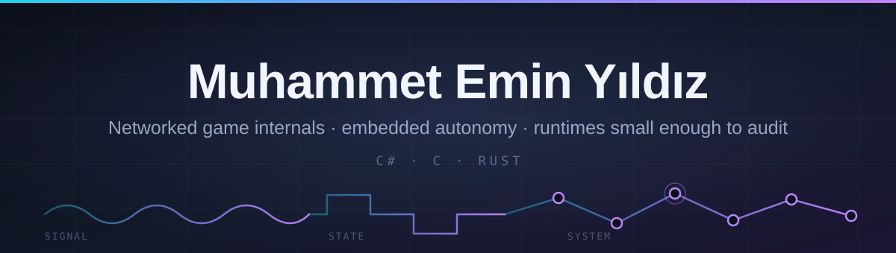

  

  
  
  
  
  

  <i>When a system is hard to reason about, I'd rather build the thing that measures it than guess.</i>

 

<h3 align="center">⭐ Featured</h3>

<table width="100%">
<tr><td valign="top">
  <h3>🧪 <a href="https://github.com/byte-me-pls/stress-lab">stress-lab</a> &nbsp;&nbsp;</h3>
  
<b>Multi-process load testing for FishNet games.</b> The Editor hosts; every bot is a separate headless build with its own transport, serializer, player loop and GC heap — so what comes back is what a second machine would actually have measured, not what a bot swarm sharing your Play Mode session can show you.

  <table>
    <tr><th align="left">Largest bone jump a spectator saw</th><th align="right"></th></tr>
    <tr><td>Snapshot replay @ 20 Hz</td><td align="right"><b>0.26 m</b></td></tr>
    <tr><td>Observer-side simulation @ 5 Hz</td><td align="right"><b>16.45 m</b></td></tr>
  </table>
  
Same scene, same players, one changed setting. The regression only existed on machines watching <i>someone else</i> fall — so it survived every session of solo playtesting.

</td></tr>
</table>

 

<h3 align="center">🛠 Tooling &nbsp;&&nbsp; Systems</h3>

<table width="100%">
<tr>
<td width="50%" valign="top">
  <h4>🎛 <a href="https://github.com/byte-me-pls/KnaveFSMSystem">KnaveFSMSystem</a></h4>
  
States are ScriptableObjects; the whole transition graph is one priority-ordered table. Read one method, you've read the character.

  
<code>C#</code> <code>Unity</code> <code>zero-alloc</code>

</td>
<td width="50%" valign="top">
  <h4>🧰 <a href="https://github.com/byte-me-pls/meyzs-toolbag">meyzs-toolbag</a></h4>
  
Every scattered editor utility — scene, transform, animation, validation — collected into one window instead of five menus.

  
<code>C#</code> <code>Unity Editor</code>

</td>
</tr>
<tr>
<td width="50%" valign="top">
  <h4>🧬 <a href="https://github.com/byte-me-pls/gen-fsm">gen-fsm</a></h4>
  
<code>no_std</code> Rust state machine whose transitions are <i>evolved</i> by a genetic algorithm. Search runs on the host; the MCU just rolls dice against a flat <code>f32</code> table.

  
<code>Rust</code> <code>no_std</code> <code>embedded</code>

</td>
<td width="50%" valign="top">
  <h4>📡 <a href="https://github.com/byte-me-pls/alkor-simulation">alkor-simulation</a></h4>
  
Rotating Leader consensus on a 4-node LoRa mesh under clock drift, 10% packet loss and EU 868 MHz duty-cycle limits.

  
🏆 <b>TEKNOFEST 2026</b> · Team OpenPolaris, Gazi University

  
<code>.NET 9</code> <code>Ed25519</code> <code>LoRa</code>

</td>
</tr>
<tr>
<td width="50%" valign="top">
  <h4>🔒 <a href="https://github.com/byte-me-pls/Horseman-lang">Horseman</a></h4>
  
A language and bytecode VM for Trusted Execution Environments. The bet: restrict the language until the runtime is small enough to read in full, and take the loss of generality as the price of an auditable TCB.

  
<code>SGX</code> <code>TrustZone</code> 

</td>
<td width="50%" valign="top">
  <h4>🦅 <a href="https://github.com/byte-me-pls/Lammergeier">Lammergeier</a></h4>
  
An autonomous drone framework designed so the radio is a detail — Wi-Fi, LoRa, FPV or analog without reworking the stack above it.

  
<code>UAV</code> <code>embedded</code> 

</td>
</tr>
</table>

 

<h3 align="center">🕹 Game Jams</h3>

<table width="100%">
<tr>
<td width="50%" valign="top">
  <h4>⚔️ <a href="https://github.com/byte-me-pls/TurkicGameJam-Game">Söz</a></h4>
  
A Dede Korkut adventure where every fight is a different game — a bullet-hell duel or a card battle, played with whatever's in your backpack.

  
Turkic Game Jam 2025

</td>
<td width="50%" valign="top">
  <h4>🦿 <a href="https://github.com/byte-me-pls/GoatGameJam">Walking City</a></h4>
  
A steampunk colony builder on legs. Every room you add is another mouth to feed, and the legs only step while there's steam.

  
Game jam

</td>
</tr>
<tr>
<td width="50%" valign="top">
  <h4>🎹 <a href="https://github.com/byte-me-pls/midimidi">Fok N Roll</a></h4>
  
A 12-lane rhythm game played on a real MIDI keyboard. No controller? A tracker layout gets you charting anyway.

  
Midi Midi Bir Kuş

</td>
<td width="50%" valign="top">
  <h4>🛣 <a href="https://github.com/byte-me-pls/ankarajam">Road Trip</a></h4>
  
A driving game about remembering. Endless procedural road, roadside events, and a radio that starts silent — you have to turn it up yourself.

  
Ankara Game Jam

</td>
</tr>
</table>

 

  networked game architecture &nbsp;·&nbsp; editor tooling &nbsp;·&nbsp; evolutionary control &nbsp;·&nbsp; small trusted computing bases

