  <picture>
    <source media="(prefers-color-scheme: dark)" srcset="assets/hero-dark.svg">
    
  </picture>

  <i>When a system is hard to reason about, I'd rather build the thing that measures it than guess.</i>

<picture>
  <source media="(prefers-color-scheme: dark)" srcset="assets/rule-dark.svg">
  
</picture>

#### <picture><source media="(prefers-color-scheme: dark)" srcset="assets/now-dark.svg"></picture>&nbsp; Now

**[Celsus](https://github.com/byte-me-pls/celsus)** &nbsp;A library that translates books without breaking their layout: every paragraph, table and caption back in its place, in about 130 languages. Rust.

#### Systems

**[stress-lab](https://github.com/byte-me-pls/stress-lab)** &nbsp;Load testing for FishNet games where every bot is its own headless build, so the numbers are what a second machine would have measured.

**[KnaveFSMSystem](https://github.com/byte-me-pls/KnaveFSMSystem)** &nbsp;A Unity state machine whose whole transition graph is one priority-ordered table.

**[gen-fsm](https://github.com/byte-me-pls/gen-fsm)** &nbsp;A `no_std` Rust state machine whose transition odds are evolved by a genetic algorithm.

**[alkor-simulation](https://github.com/byte-me-pls/alkor-simulation)** &nbsp;Rotating-leader consensus on a four-node LoRa mesh, under clock drift and packet loss. TEKNOFEST 2026.

**[Lammergeier](https://github.com/byte-me-pls/Lammergeier)** &nbsp;An autonomous drone framework where the radio is a detail. Design stage.

**[meyzs-toolbag](https://github.com/byte-me-pls/meyzs-toolbag)** &nbsp;The scattered Unity Editor utilities, in one window.

#### Games

[Söz](https://github.com/byte-me-pls/TurkicGameJam-Game) &nbsp;·&nbsp; [Walking City](https://github.com/byte-me-pls/GoatGameJam) &nbsp;·&nbsp; [Fok N Roll](https://github.com/byte-me-pls/midimidi) &nbsp;·&nbsp; [Road Trip](https://github.com/byte-me-pls/ankarajam)

<picture>
  <source media="(prefers-color-scheme: dark)" srcset="assets/rule-dark.svg">
  
</picture>

C# &nbsp;·&nbsp; C &nbsp;·&nbsp; Rust &nbsp;·&nbsp; Unity

